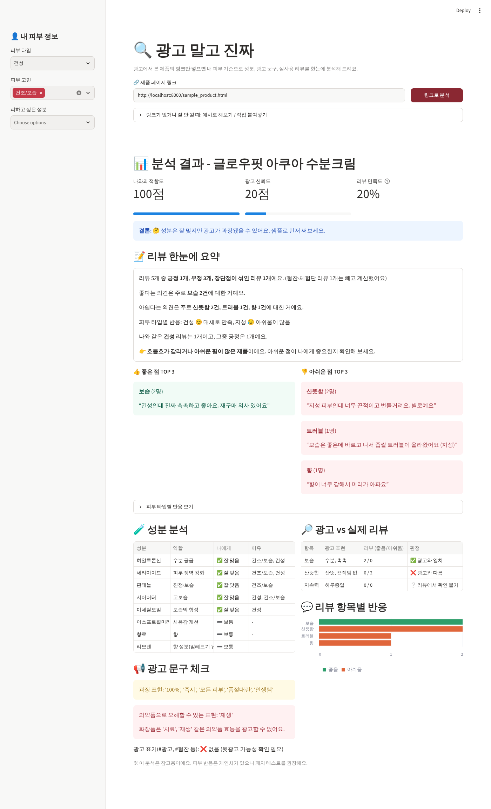

# 🔍 광고 말고 진짜 – AI 화장품 판별 봇

> 2026-2학기 AI 교과 연계 프로젝트 공모전 출품작

인스타 광고나 인플루언서가 추천하는 화장품을 보고 **"이거 믿어도 될까? 나한테 맞을까?"** 고민될 때,
제품 페이지 **링크만 넣으면** 광고 문구, 전성분, 실사용 리뷰를 찾아서 **내 피부 정보 기준으로** 한눈에 정리해 주는 웹앱입니다.
유료 AI API 없이 **완전히 무료**로 동작합니다.



## 주요 기능
| 기능 | 설명 |
|---|---|
| 🔗 링크로 분석 | 제품 페이지 링크를 넣으면 광고 문구, 전성분, 리뷰를 자동으로 찾아 바로 분석 |
| 👤 내 피부 정보 | 피부 타입, 고민, 피하고 싶은 성분을 입력 |
| 🧪 성분 분석 | 전성분에서 주요 성분을 찾아 나에게 **잘 맞음 / 주의**로 분류 |
| 📢 광고 문구 체크 | 과장 표현("100%", "즉시"), 의약품 오인 표현("치료", "재생"), #광고 표기 여부 확인 |
| 🔎 광고 vs 실제 리뷰 | 광고가 주장한 효과(보습, 산뜻함, 백탁 없음 등)가 리뷰에서도 맞는지 비교 |
| 📝 리뷰 한눈에 요약 | 전체 리뷰를 요약 문장으로 정리하고, 좋은 점/아쉬운 점 TOP 3를 대표 리뷰와 함께 보여줌 |
| 💬 리뷰 분석 | "보습은 좋은데 끈적여요"처럼 장단점이 섞인 리뷰도 나눠서 분석, 피부 타입별 반응, 협찬 리뷰는 빼고 계산 |
| 📊 종합 점수 | 나와의 적합도, 광고 신뢰도, 한 줄 결론 |
| ✍️ 직접 붙여넣기 | 링크가 안 되는 사이트는 직접 붙여넣거나, 예시 제품 3개로 바로 시연 |

### 링크 분석이 잘 되는 경우 / 안 되는 경우
- ✅ 브랜드 공식몰처럼 **성분과 문구가 글자로 된 페이지**
- ✅ 검색엔진용 제품 정보(JSON-LD)에 리뷰를 넣어둔 페이지
- ❌ 성분표가 **이미지로만** 된 상세페이지 → 성분을 직접 붙여넣기
- ❌ 자동 접속을 막거나 리뷰를 나중에 불러오는 **대형 쇼핑몰** → 리뷰를 직접 붙여넣기

못 찾은 항목은 화면에 안내 문구가 나옵니다. 대량 자동 수집은 사이트 이용약관에 어긋날 수 있어서, 사용자가 넣은 링크 한 페이지만 읽습니다.

## 실행 방법
```bash
pip install -r requirements.txt
streamlit run app.py
```
브라우저에서 `http://localhost:8501`이 열립니다.

링크 분석을 시험해 보려면 다른 터미널에서 예시 페이지를 띄우고 아래 링크를 넣어 보세요.
```bash
python -m http.server 8000 --directory demo
# 앱에 입력: http://localhost:8000/sample_product.html
```

무료로 인터넷에 공개하려면 이 저장소를 [Streamlit Community Cloud](https://streamlit.io/cloud)에 연결하고 `app.py`를 선택하면 됩니다.

## 파일 구성
- `app.py` – 화면 (Streamlit)
- `analyzer.py` – 성분 사전, 광고·리뷰 분석 규칙, 점수 계산
- `fetcher.py` – 링크의 페이지에서 광고 문구, 전성분, 리뷰를 찾는 기능
- `sample_data.py` – 시연용 가상 제품 데이터
- `demo/sample_product.html` – 링크 분석을 시험해 볼 수 있는 가상 제품 페이지

## 교과목 연계 포인트
- **소비자 구매결정과정**: 정보 탐색, 대안 평가 단계를 AI가 도와줌
- **정보 비대칭 / 지각된 위험**: 광고와 실제 사용 후기의 차이를 보여줘 구매 전 위험을 줄임
- **소비자 보호**: 화장품 광고에서 금지된 의약품 오인 표현, 뒷광고 여부 확인

※ 분석 결과는 참고용이며, 피부 반응은 개인차가 있습니다.
